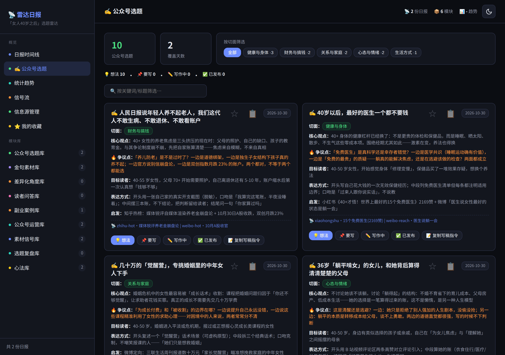
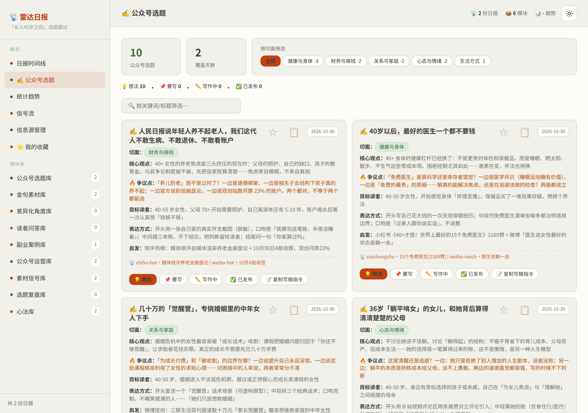

# 📡 雷达日报 · 自媒体创作者版

> **🌗 双主题**：深色极简 / 暖色杂志，点顶栏 🌙/☀️ 按钮随时切换，也可用 `?theme=light` / `?theme=dark` 深链指定。

<table>
  <tr>
    <td align="center"><br><b>深色极简</b></td>
    <td align="center"><br><b>暖色杂志</b></td>
  </tr>
</table>

> 截图为「✍️ 公众号选题」专页：选题卡（核心观点 / 争议点 / 表达方式）、状态流按钮（想法→要写→写作中→已发布）、切面筛选、一键复制写稿指令。

自媒体创作者的选题雷达——每天自动采集 **14 个信息源**（微博热搜 / 知乎热榜 / B站 / 小红书 / 抖音 / 百度 / 澎湃 / 网易 / 雪球 Hunt / V2EX…），由 AI 生成每日选题日报，帮你找到值得开口说的话题。

> 🎁 已内置示例数据，安装完打开就能看到完整效果。
>
> ✍️ **本版本面向「公众号 · 女人 40 岁之后」**——这是作者正在运营的内容方向，日报会以「公众号选题」为最高优先级模块（Hook 标题 / 核心观点 / 真争议点 / 表达方式），面板有独立的选题专页。如果你关注**其他内容方向**（知识科普、亲子、职场……），改提示词即可，见 [🧭 自定义方向](#-自定义方向)。

本项目基于开源项目 [susumr/radar-dashboard](https://github.com/susumr/radar-dashboard)（独立开发者方向）二次开发：保留了「采集 → 生成 → 展示」的管道架构与双主题面板，将信号源与日报生成全面改造为自媒体选题场景。

---

## ⚡ 快速开始（3 步）

```bash
# 1. 安装（创建环境 + 装依赖 + 生成配置）
bash install.sh

# 2. 启动
bash start.sh

# 3. 打开浏览器
# 访问 http://127.0.0.1:5080
```

### 🤖 不想手动装？让 AI 帮你

把下面这段话发给任意 AI 编程助手（Hermes / Cursor / Claude Code…），它会帮你完成全部安装：

> 帮我安装并启动这个开源项目：https://github.com/chenty/radar-dashboard
> 步骤：1) clone 到本地 2) 运行 install.sh 3) 运行 start.sh 4) 确认服务在 http://127.0.0.1:5080 能打开
> 我做「女人 40 岁之后」方向的公众号，顺便读一下 README 告诉我怎么配置 .env（DeepSeek Key 等）。

如果你用的是 [Hermes Agent](https://hermes-agent.nousresearch.com)，还可以让它**全自动接管**：每天定时采集 → AI 生成日报 → 推送消息，详见文末「生成每日 AI 日报」方式 B。

## 📊 功能一览

| 页面 | 说明 |
|------|------|
| **日报时间线** | 每日 AI 选题日报（公众号选题 / 金句素材 / 副业案例 / 心法…） |
| **✍️ 公众号选题** | ⭐ 本版核心：聚合每日选题（标题 / 观点 / 争议点 / 表达建议） |
| **📡 信号流** | tophub 式热榜：左侧 14 个源，右侧紧凑榜单 |
| **🔌 信息源管理** | 各平台接入状态 |
| **⭐ 我的收藏** | 收藏单条信息 + 复制发给 AI 分析 |

## 📡 数据源（14 个）

| 类别 | 源 | 说明 |
|------|-----|------|
| **核心中文源** | weibo-hot 🔥 / zhihu-hot 🧩 / bili-hot 📺 / kr36-flash 📰 | 大众情绪、观点争议、生活方式趋势——公众号选题的富矿 |
| **定向搜索**（需登录） | xiaohongshu / bilibili-reach / weibo-reach | 面向「女人 40 岁之后」的 4 组关键词定向搜索，挖热榜之外的长尾高共鸣内容 |
| **财务切面** | xueqiu-reach（雪球热帖） | 中年理财 / 养老规划讨论 |

> 定向搜索源通过 [Agent Reach](https://github.com/Panniantong/Agent-Reach) 接入（小红书/B站需本人扫码登录一次；微博走浏览器渲染免登录）。登录态过期时对应源静默缺失，不影响其他源。

## 🧭 自定义方向

本版**偏重「女人 40 岁之后」**：日报里「公众号选题」模块是最高优先级（每天 3-5 条），面板左侧也有专页。这套逻辑在 **AI 生成日报时的提示词**里定义，不在代码里——想换内容方向，改提示词就行。

### 方案 A：只改方向，不动代码（推荐）

「日报生成提示词」决定 AI 输出哪些模块、偏重什么：

| 你的场景 | 改哪里 |
|---------|--------|
| 手动用 ChatGPT/Claude/DeepSeek 生成日报 | 改本 README「生成每日 AI 日报」里给 AI 的那段话（把「女人 40 岁之后」换成你的方向） |
| 用 Hermes 自动生成（cron） | 改 Hermes cron job 的 prompt（模块内容规则） |

**想改成其他内容方向**：把提示词里的选题规则换成你的定位即可，例如「面向宝妈的育儿科普：每条选题含 Hook 标题 / 核心观点 / 争议点 / 表达建议」。同时把 `scripts/daily_signals.py` 里三个 `fetch_*_reach()` 的关键词列表换成你方向相关词。

**想恢复独立开发者方向**：本项目的上游 [susumr/radar-dashboard](https://github.com/susumr/radar-dashboard) 就是完整原版，直接用它更省事。

### 方案 B：增删数据源

| 做什么 | 改哪里 |
|-------|--------|
| 加/删采集源 | `scripts/daily_signals.py`（采集逻辑）+ `app.py` 的 `SOURCE_META`（面板信息源管理页显示） |
| 调整页面模块 | `templates/index.html`（前端，单文件） |

## 🤖 给 AI Agent（Hermes / Cursor / Claude Code…）的阅读指南

这个仓库是一个**「采集 → 生成 → 展示」三段式数据管道**，Agent 接手时按这个顺序读：

1. **数据从哪来**：`scripts/daily_signals.py` 每天并行抓取 14 个源，原始信号存 `data/raw_signals/YYYY-MM-DD.json`（按平台分组，含 url）。三个 `fetch_*_reach()` 定向源依赖 Agent Reach 登录态 / 浏览器渲染缓存（`~/.hermes/cache/weibo_reach_last_page.html`，1 小时有效，缺失时自动跳过）。
2. **日报怎么生成**：把采集到的信号交给 LLM，按**日报 JSON 格式**整理成 `data/reports/YYYY-MM-DD.json`。核心结构：
   ```json
   { "date": "2026-10-30", "sources": {"weibo-hot": 40, ...}, "tags": [...],
     "modules": { "publicAccountTopics": [...], "quoteBank": [...], "dataSignals": [...],
                  "sidebizCases": [...], "growthOps": [...], "dailyWisdom": {...} } }
   ```
   全部模块键：publicAccountTopics（选题）/ quoteBank（金句）/ angles（差异化角度，待接）/
   readerQA（读者问答，待接）/ sidebizCases（副业案例）/ growthOps（公众号运营）/
   dataSignals（素材信号）/ dailyWisdom（心法）。
   「公众号选题」就是 `modules.publicAccountTopics` 数组（字段：title / signal / corePoint / controversy / audience / expression / relatedSignal）——面板专页直接读它，跨日期自动聚合。
3. **怎么展示**：`app.py`（Flask 后端，只读 JSON 出 REST API）+ `templates/index.html`（单文件前端，双主题，hash 路由）。后端无数据库，纯文件即数据。
4. **要自动化的 Agent**：用 Hermes cron job 每天 08:45 跑采集脚本 + 按 README 提示词生成日报（本项目实际在用的方式）。
5. **Key 约定**：脚本按 环境变量 → 项目 `.env` → `~/.hermes/.env`（Hermes 用户的 Key，自动复用）的顺序读 `DEEPSEEK_API_KEY`；`TRUSTMRR_API_KEY` / `PH_TOKEN` / `REDDIT_*` 只从环境变量和项目 `.env` 读。

**Agent 要做的日常操作**：加数据源（改 daily_signals.py + SOURCE_META）、改日报风格（改 cron prompt 模板）、修展示（改 index.html）、跑采集（`venv/bin/python scripts/daily_signals.py`）。

## 🔄 每日数据采集

```bash
# 手动采集一次（约 1 分钟，14 个源）
venv/bin/python scripts/daily_signals.py

# 自动采集：加到系统定时任务（每天 08:45）
crontab -e
# 添加一行：
45 8 * * * cd /你的路径/radar-dashboard && /你的路径/radar-dashboard/venv/bin/python scripts/daily_signals.py >> data/collect.log 2>&1
```

采集后：
- 原始信号 → `data/raw_signals/` → 「信号流」页可见
- 每日 AI 日报 → 手动生成（见下）→ 「日报时间线」页可见

## 🤖 生成每日 AI 日报（可选）

「日报时间线」的日报需要 AI 生成。有两种方式：

### 方式 A：用任意 AI 工具（免费，无需额外配置）

1. 先跑采集：`venv/bin/python scripts/daily_signals.py`
2. 把终端输出的信号列表**复制**给任何 AI（ChatGPT/Claude/DeepSeek）
3. 让 AI 按下面的格式整理成日报 JSON（**想改方向？把这里的话也改掉**）：
   > 你是「女人 40 岁之后」公众号的每日选题雷达。从信号里精选，输出（素材不足的模块省略）：
> 1. **公众号选题**（最高优先级，3-5 条）：Hook 标题 / 内容切面（只能取：自我成长/健康与身体/财务与搞钱/关系与家庭/心态与情绪/生活方式 之一，各条覆盖不同切面）/ 信号来源 / 核心观点 / 真争议点（两面性）/ 40+ 女性读者画像 / 表达方式建议 / 关联信号——不鸡汤、不泛科普，热榜话题优先落到 40+ 女性真实处境
> 2. **金句素材**（2-4 条）：可直接引用的原话 / 说话者 / 主题 / 适合用在开头·过渡·结尾
> 3. **素材信号**（3-6 条）：观察 / 判断 / 可引用原话 / 可写入文章的角度
> 4. **40+ 女性副业案例**（1-2 条，只收真实可查的）：谁 / 做了什么 / 收入（不确定写「未核实」）/ 做了多久 / 能否复制
> 5. **公众号运营**（1 条，对本号可执行的）：策略 / 适用场景
> 6. **今日心法**：一句话方法论 / 场景 / 步骤 / 从当天数据如何提炼
4. 把 AI 返回的 JSON 保存为 `data/reports/{日期}.json`（结构见上「Agent 阅读指南」）

### 方式 B：接入 Hermes Agent（完整自动化）

雷达日报原生跑在 [Hermes Agent](https://hermes-agent.nousresearch.com) 上，配置 cron 后每天 08:45 自动采集 → AI 生成日报 → 推送到会话。配置步骤见下文「生成每日 AI 日报 · 方式 B」。

## 🔧 配置说明（.env）

全部可选，不填也能跑。现有 14 源均免登录、无需任何 API Key。

| Key | 作用 | 获取 | 优先级 |
|-----|------|------|--------|
| `DEEPSEEK_API_KEY` | 英文信号自动翻译中文（现役 14 源全中文，基本用不上） | https://platform.deepseek.com/ | ⚪ 可不配 |

> 💡 **用了 Hermes 就不用重复配 DeepSeek Key**：采集脚本会自动读取 `~/.hermes/.env` 里的 `DEEPSEEK_API_KEY`，无需在项目 `.env` 里再填一遍。
>
> ⚪ **Reddit 建议不配**：Reddit 对数据中心 IP 风控严格，不配也不影响其他源。

## 🗂️ 目录结构

```
radar-dashboard/
├── app.py                  # Web 后端（REST API，只读 JSON）
├── templates/index.html    # 前端页面（单文件，双主题，hash 路由）
├── scripts/
│   ├── daily_signals.py    # 数据采集脚本（14 源，含 4 个 agent-reach 定向源）
│   ├── weibo_render_urls.py        # 微博定向搜索 URL 列表
│   ├── weibo_reach_search.py       # 微博采集辅助
│   └── screenshot.py       # 生成 README 截图（Playwright）
├── docs/                   # 截图等静态资源
├── data/
│   ├── reports/            # 日报 JSON
│   ├── raw_signals/        # 原始信号 JSON
│   └── favorites.json      # 你的收藏
├── requirements.txt
├── install.sh              # 一键安装
├── start.sh                # 启动
└── .env                    # 配置（可选）
```

## ❓ 常见问题

**打开后没有数据？**
先跑一次采集并生成日报（见「生成每日 AI 日报」方式 A），数据会按日期自动展示。

**小红书 / B站定向搜索没数据？**
这两个源需要本人扫码登录（Agent Reach 专用浏览器）：`agent-reach login xiaohongshu` / `agent-reach login bilibili`。登录态过期时源会静默缺失，重新登录即恢复。微博源需要 agent 侧先渲染页面（详见 Agent 阅读指南）。

**没有 DeepSeek Key 会怎样？**
英文内容不翻译，显示原文。其他功能正常。

**数据存在哪？**
全部在本机 `data/` 目录，纯 JSON 文本，方便备份迁移。

**想换端口？**
`start.sh` 里把 5080 改成你想要的端口。

---

## 📄 来源与致谢

本项目基于 [susumr/radar-dashboard](https://github.com/susumr/radar-dashboard)（原作者是独立开发者，面向小程序/出海产品机会发现）二次开发，感谢其开源的「采集 → 生成 → 展示」管道架构与面板设计。本版本将场景改造为**自媒体内容选题**，信号源、日报 prompt 与模块结构均有较大改动，与上游不互相兼容。
